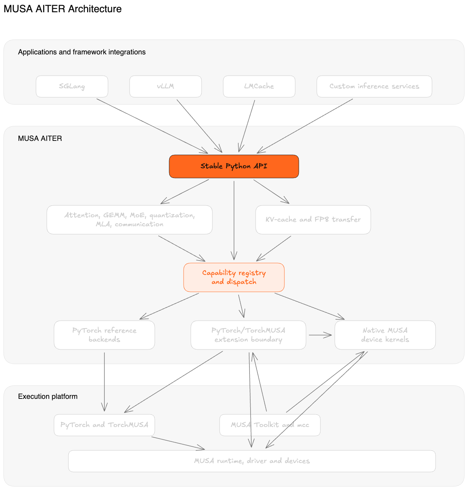

# MUSA AITER

[中文 README](README.md)

**MUSA AITER** is an open-source operator and kernel library for large-language-model workloads on Moore Threads MUSA. It provides a stable Python API, PyTorch reference implementations, and selected native MUSA kernels for attention, tensor operations, quantization, mixture-of-experts, model-parallel communication, and KV-cache movement.

The project is MUSA-focused. CPU/reference execution is available for development and correctness testing; native execution requires a compatible PyTorch/TorchMUSA stack and MUSA runtime. The current package version is **0.5.0**.

## Project Focus

At this stage, MUSA AITER focuses on KV-cache movement and layout conversion for large-language-model inference, including:

- Paged KV-cache and FP8 KV-cache paths.
- LMCache/SGLang-compatible layouts and cross-framework KV transfer.
- DeepSeek V4-style flat and row-oriented KV transfer.
- CPU/reference correctness paths and native acceleration through TorchMUSA and MUSA.

The project is still evolving. Native coverage, numerical behavior, and performance should be evaluated on the target MUSA hardware and software stack.

## Highlights

- Attention APIs, including dense, paged, and sparse decode paths.
- GEMM, grouped GEMM, MoE routing, normalization, quantization, MLA, and communication primitives.
- KV-cache conversion and movement across paged, linear, merged, MLA, FP8, LMCache, and SGLang MP layouts.
- DeepSeek V4-style flat and row-oriented KV transfer paths.
- Native MUSA kernels written in MUSA device code, plus narrow PyTorch/TorchMUSA extension boundaries where appropriate.
- Capability discovery and backend dispatch through `musa-aiter list-ops`.

## Architecture



The public API is the integration boundary. The registry selects an available implementation for each operation. Reference backends run through PyTorch. Native paths have two layers: the extension boundary uses PyTorch/TorchMUSA tensor, device, and stream interfaces; MUSA device kernels are compiled with `mcc` and execute through the MUSA runtime/driver.

## Install

MUSA AITER keeps PyTorch outside its mandatory package dependencies so that it does not replace a vendor-specific TorchMUSA stack. Choose the installation path that matches your environment.

### MUSA

Install the vendor-approved, version-matched `torch` and `torch_musa` stack first, following the [TorchMUSA documentation](https://github.com/MooreThreads/torch_musa). Do not run `pip install torch` from the public PyPI index on a MUSA environment. Then install the base package without dependency resolution:

```bash
python3 -m pip install --no-deps musa-aiter
python3 -c "import torch, torch_musa; print(torch.__version__); print(torch.musa.is_available())"
```

`--no-deps` is intentional: the base package currently has no mandatory runtime dependencies, and this keeps pip from changing the already-installed vendor stack. Do not use the `[cpu]` extra on a MUSA environment.

### CPU/reference

For CPU/reference use only, the optional extra installs upstream PyTorch as a convenience:

```bash
python3 -m pip install "musa-aiter[cpu]"
```

Do not use this extra in an environment that already contains vendor TorchMUSA packages.

### Source development

For source development on a MUSA environment, keep the vendor stack intact and install the project without dependencies:

```bash
python3 -m pip install --no-deps -e .
```

For CPU/reference development and tests:

```bash
python3 -m pip install -e ".[dev]"
python3 -m pytest op_tests -q
```

For native MUSA execution, install a vendor-matched PyTorch and [TorchMUSA](https://github.com/MooreThreads/torch_musa), together with the MUSA runtime and toolkit described by the corresponding vendor documentation. Then install this project in editable or wheel form with `--no-deps`.

Documentation tools are optional:

```bash
python3 -m pip install -e ".[docs]"
mkdocs serve
```

## Usage

Reference operations can be used directly from Python:

```python
import torch
import musa_aiter

a = torch.randn(4, 8)
b = torch.randn(8, 16)
out = musa_aiter.gemm(a, b)
```

Discover the registered operations and their supported backends:

```bash
musa-aiter list-ops
musa-aiter list-ops --family kvcache
musa-aiter list-ops --json
```

The CLI also provides a lightweight environment check:

```bash
musa-aiter check --soft
```

## KV-cache support

The KV-cache API covers common inference layouts and framework transfer boundaries:

| Area | Examples |
| --- | --- |
| Paged and linear conversion | Single-layer and multi-layer K/V gather and scatter |
| Merged and MLA layouts | Merged K/V tensors and asymmetric MLA/DSA flat caches |
| FP8 cache movement | E4M3/E5M2 payloads, raw `uint8` storage, scalar and head-aware scales |
| Framework transfer | LMCache-compatible buffers and SGLang MP `2 x NL x [NB, BS, NH, HS]` caches |
| Model-specific layouts | DeepSeek V4 flat and row-oriented KV transfer |

Relevant integration references:

- [SGLang integration](docs/SGLANG_INTEGRATION_GUIDE.md)
- [vLLM integration](docs/VLLM_0_20_INTEGRATION_GUIDE.md)

Native KV paths are selected only when their device, dtype, layout, and runtime requirements are satisfied. Otherwise, supported APIs retain their reference behavior. Fused consumption of FP8 data by every attention backend is not yet available.

## Native MUSA

Native coverage varies by operation and by the installed TorchMUSA and MUSA toolkit versions. Native kernel sources live under `csrc/`; public Python APIs do not require callers to depend on the native ABI directly.

When validating a native environment, use the project CLI and the MUSA-marked tests:

```bash
python3 scripts/validate_native_musa_env.py --strict
python3 -m pytest op_tests -q -m musa
```

## Documentation

- [Architecture](docs/ARCHITECTURE.md)
- [API policy](docs/API_POLICY.md)
- [Package and installation](docs/deploy/package-install.md)
- [Examples](examples/README.md)
- [Documentation index](docs/index.md)

## Project status

MUSA AITER is an early-stage project. Reference APIs cover a broad operator surface, while native kernel coverage continues to expand. Performance, numerical behavior, and available dtypes should be evaluated on the target MUSA hardware and software stack.

## License

MUSA AITER is released under the [MIT License](LICENSE).
