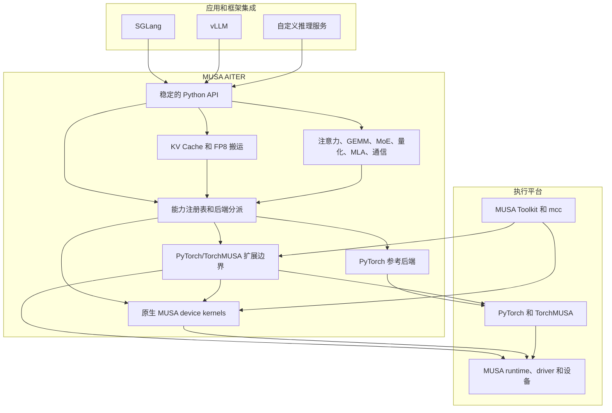

# MUSA AITER

[English README](README.en.md)

**MUSA AITER** 是面向 Moore Threads MUSA 的开源算子与内核库，服务于大语言模型推理和相关张量计算场景。项目提供稳定的 Python API、基于 PyTorch 的参考实现，以及部分面向 MUSA 的原生内核，覆盖注意力、张量运算、量化、混合专家、模型并行通信和 KV Cache 搬运等能力。

项目以 MUSA 为重点。CPU/reference 路径可用于开发和正确性测试；原生加速路径需要兼容的 PyTorch/TorchMUSA 软件栈和 MUSA 运行时。当前软件包版本为 **0.5.0**。

## 项目重点

当前阶段，MUSA AITER 重点围绕大模型推理中的 KV Cache 搬运与布局转换展开，主要包括：

- 分页 KV Cache 和 FP8 KV Cache 路径。
- LMCache/SGLang 兼容的数据布局和跨框架 KV 搬运。
- DeepSeek V4 风格的 flat 和 row-oriented KV 搬运。
- CPU/reference 正确性路径，以及基于 TorchMUSA + MUSA 的原生加速路径。

项目仍处于持续扩展阶段。不同算子的原生覆盖范围、数值行为和性能，应以目标 MUSA 硬件和软件栈上的验证结果为准。

## 主要能力

- 注意力 API，包括 dense、paged 和 sparse decode 路径。
- GEMM、grouped GEMM、MoE 路由、归一化、量化、MLA 和通信原语。
- 支持 paged、linear、merged、MLA、FP8、LMCache 和 SGLang MP 布局的 KV Cache 转换与搬运。
- DeepSeek V4 风格的 flat 和 row-oriented KV 搬运路径。
- 使用 MUSA device code 编写的原生 MUSA 内核，以及必要的 PyTorch/TorchMUSA 扩展边界。
- 通过 `musa-aiter list-ops` 发现能力并进行后端分派。

## 架构



公共 API 是项目与上层框架之间的集成边界。能力注册表会为每个算子选择可用实现。参考后端通过 PyTorch 执行。原生路径分为两部分：扩展边界使用 PyTorch/TorchMUSA 的张量、设备和 stream 接口；MUSA device kernels 由 `mcc` 编译，并通过 MUSA runtime/driver 在设备上执行。

## 安装

MUSA AITER 不把 PyTorch 放入强制运行时依赖，因此不会自动替换已有的厂商 TorchMUSA 软件栈。请根据目标环境选择安装路径。

### MUSA 环境

先按照 [TorchMUSA 文档](https://github.com/MooreThreads/torch_musa) 安装版本匹配、经过厂商验证的 `torch` 和 `torch_musa` 软件栈。MUSA 环境不要从公共 PyPI 直接执行 `pip install torch`。完成软件栈准备后，再安装 MUSA AITER：

```bash
python3 -m pip install --no-deps musa-aiter
python3 -c "import torch, torch_musa; print(torch.__version__); print(torch.musa.is_available())"
```

这里使用 `--no-deps` 是有意的：当前基础包没有强制运行时依赖，这样可以避免 pip 修改已经安装好的厂商软件栈。MUSA 环境不要使用 `[cpu]` extra。

### CPU/reference 环境

仅用于 CPU/reference 开发和测试时，可以使用可选 extra 安装上游 PyTorch：

```bash
python3 -m pip install "musa-aiter[cpu]"
```

如果环境中已经安装厂商 TorchMUSA 软件包，不要使用这个 extra。

### 源码开发

在 MUSA 环境中进行源码开发时，保持厂商软件栈不变，并在不解析依赖的情况下安装项目：

```bash
python3 -m pip install --no-deps -e .
```

在 CPU/reference 环境中进行开发和测试：

```bash
python3 -m pip install -e ".[dev]"
python3 -m pytest op_tests -q
```

如果需要运行原生 MUSA 路径，请先根据厂商文档安装版本匹配的 PyTorch、[TorchMUSA](https://github.com/MooreThreads/torch_musa)、MUSA 运行时和工具链，再使用 `--no-deps` 以 editable 或 wheel 形式安装本项目。

文档工具是可选的：

```bash
python3 -m pip install -e ".[docs]"
mkdocs serve
```

## 使用

可以直接从 Python 调用参考算子：

```python
import torch
import musa_aiter

a = torch.randn(4, 8)
b = torch.randn(8, 16)
out = musa_aiter.gemm(a, b)
```

查看已注册的算子及其支持的后端：

```bash
musa-aiter list-ops
musa-aiter list-ops --family kvcache
musa-aiter list-ops --json
```

CLI 还提供轻量级环境检查：

```bash
musa-aiter check --soft
```

## KV Cache 支持

KV Cache API 覆盖常见推理布局和框架传输边界：

| 方向 | 示例 |
| --- | --- |
| Paged 和 linear 转换 | 单层和多层 K/V gather 与 scatter |
| Merged 和 MLA 布局 | merged K/V 张量以及非对称 MLA/DSA flat cache |
| FP8 Cache 搬运 | E4M3/E5M2 数据、原始 `uint8` 存储、标量和按 head 的 scale |
| 框架传输 | LMCache 兼容 buffer，以及 SGLang MP `2 x NL x [NB, BS, NH, HS]` cache |
| 特定模型布局 | DeepSeek V4 flat 和 row-oriented KV 搬运 |

相关集成文档：

- [SGLang 集成](docs/SGLANG_INTEGRATION_GUIDE.md)
- [vLLM 集成](docs/VLLM_0_20_INTEGRATION_GUIDE.md)

只有在设备、数据类型、布局和运行时条件均满足时，系统才会选择原生 KV 路径；否则支持的 API 会保留参考实现行为。目前并非所有注意力后端都支持直接消费 FP8 数据。

## 原生 MUSA

原生能力覆盖范围取决于算子以及已安装的 TorchMUSA 和 MUSA Toolkit 版本。原生内核源码位于 `csrc/`；公共 Python API 不要求调用方直接依赖原生 ABI。

验证原生环境时，请使用项目 CLI 和带有 `musa` 标记的测试：

```bash
python3 scripts/validate_native_musa_env.py --strict
python3 -m pytest op_tests -q -m musa
```

## 文档

- [架构说明](docs/ARCHITECTURE.md)
- [API 策略](docs/API_POLICY.md)
- [安装和部署](docs/deploy/package-install.md)
- [示例](examples/README.md)
- [文档索引](docs/index.md)

## 项目状态

MUSA AITER 目前仍处于早期阶段。参考 API 已覆盖较广的算子范围，原生内核覆盖仍在扩展。请在目标 MUSA 硬件和软件栈上评估性能、数值行为以及可用数据类型。

## 许可证

MUSA AITER 使用 [MIT License](LICENSE) 发布。第三方组件及其版权和许可证信息见 [ThirdPartyNotices.txt](ThirdPartyNotices.txt)。
