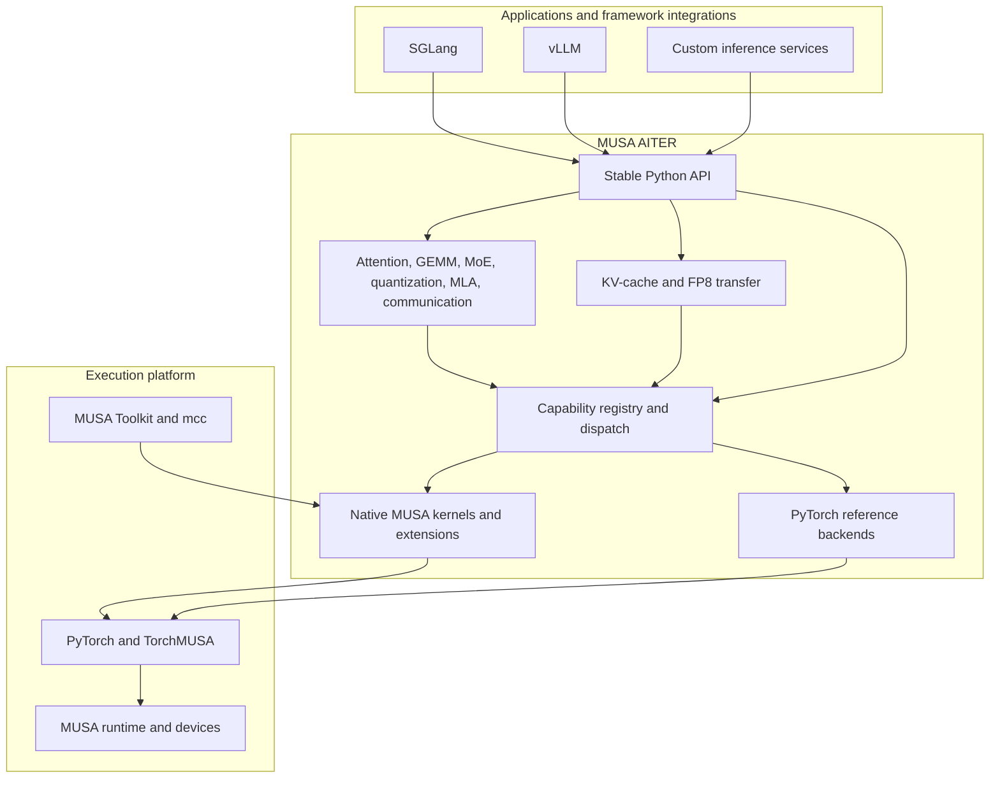

# Architecture

MUSA AITER separates the public operator API from backend selection and native implementation details. This keeps framework integrations stable while allowing an operation to use a PyTorch reference implementation or a native MUSA implementation when the runtime supports it.

## Layers

### Applications and integrations

Frameworks and inference services call the stable Python API. The integration layer owns request scheduling, model execution, and framework-specific cache metadata; MUSA AITER owns operator execution and cache movement primitives.

### Public API

The package exports operators for attention, GEMM, normalization, MoE, quantization, MLA, communication, and KV-cache transfer. Framework-specific code can use these APIs without calling a native symbol directly.

### Registry and dispatch

The capability registry describes operation families, supported dtypes, devices, and available backends. Dispatch selects a native path when its requirements are met and preserves reference behavior for supported fallback cases.

### Reference backends

Reference implementations use PyTorch tensor operations. They support development and correctness tests on machines without a MUSA device.

### Native backends

Native implementations use MUSA device code under `csrc/` and selected PyTorch/TorchMUSA extension boundaries. The native layer receives validated tensor metadata and the current execution stream where required.

### Platform

PyTorch provides the tensor programming interface. TorchMUSA connects PyTorch to MUSA devices, and the MUSA toolkit provides the compiler and runtime components needed by native kernels.

## Data paths

The main data paths are:

1. Framework request -> public Python operator -> registry dispatch -> reference or native backend.
2. Linear K/V -> paged or model-specific KV cache -> linear K/V.
3. Framework cache metadata and buffers -> LMCache/SGLang-compatible transfer API -> MUSA cache tensors.

Native availability is a runtime property. It depends on the operation, tensor layout and dtype, TorchMUSA support, toolkit version, and device capabilities.
